<p align="center">
  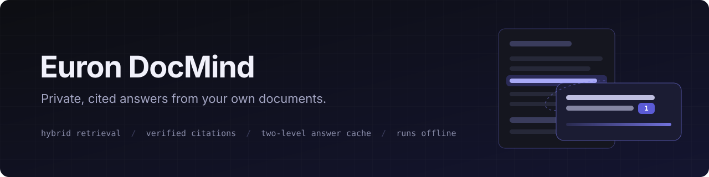
</p>

<p align="center">
  
  <a href="LICENSE"></a>
  
  
  
  
  
  
</p>

<p align="center">
  <a href="https://github.com/euron-sde-team/euron-doc-mind/stargazers"></a>
  <a href="https://github.com/euron-sde-team/euron-doc-mind/fork"></a>
  <a href="https://github.com/euron-sde-team/euron-doc-mind/watchers"></a>
  <br>
  <a href="https://github.com/euron-sde-team/euron-doc-mind/issues"></a>
  <a href="https://github.com/euron-sde-team/euron-doc-mind/pulls"></a>
  <a href="https://github.com/euron-sde-team/euron-doc-mind/commits/main"></a>
  
  <br>
  <a href="#built-by-the-team-behind-euron"></a>
</p>

<p align="center">
  <b><a href="#-quickstart">Quickstart</a></b> ·
  <b><a href="#️-architecture">Architecture</a></b> ·
  <b><a href="#-explore-the-repository">Explore the repo</a></b> ·
  <b><a href="docs/api/openapi.json">API reference</a></b> ·
  <b><a href="#️-deploy-to-aws">Deploy</a></b> ·
  <b><a href="docs/architecture/security.md">Security</a></b> ·
  <b><a href="#-documentation">Docs</a></b>
</p>

**Euron DocMind** is an open-source, MIT-licensed assistant that answers questions from your
own documents, part of the open-source initiative of **ENGAGESPHERE TECHNOLOGY PRIVATE
LIMITED**. Upload PDFs, Word files, spreadsheets, slide decks, Markdown, HTML or plain text
into a workspace, ask in plain language, and get an answer in which every sentence is cited
back to the exact passage it came from.

It is built for documents you cannot paste into a public chatbot:

- Files are parsed, chunked and embedded locally. No document leaves your infrastructure
  unless you choose a hosted model, and even then only the few passages an answer needs.
- Every claim carries a citation that opens the source document at the highlighted passage.
- A token meter shows what each answer cost against pasting the whole library into a
  prompt, and a two-level cache answers repeated questions in milliseconds.

The whole stack runs on a laptop with no API key (a built-in extractive answerer composes
answers from your documents' own sentences), against an AWS emulator, and deploys to AWS
with one command from the same Terraform.

<p align="center">
  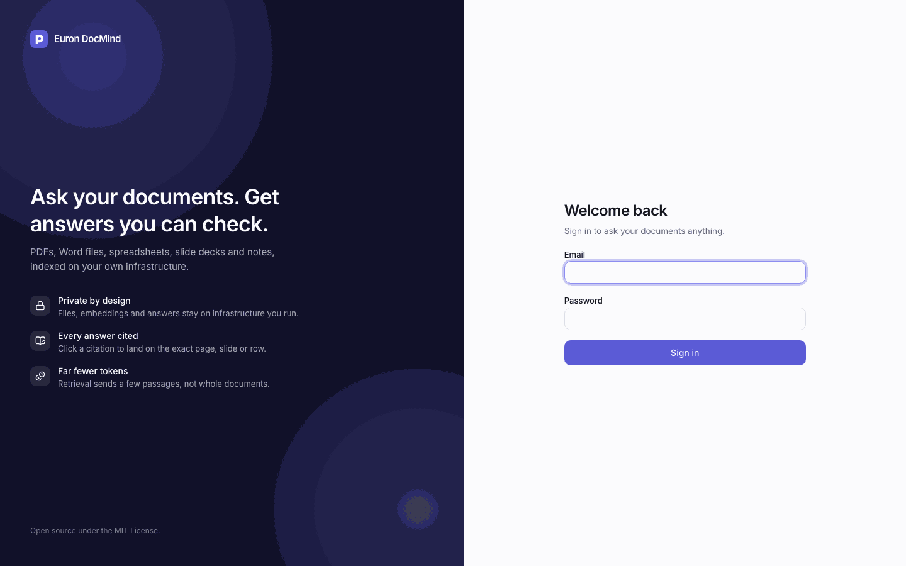
</p>

> [!NOTE]
> Everything in the tour ran for real: Docker Compose on a laptop, with S3, SQS, KMS and
> Secrets Manager emulated locally and provisioned by the same Terraform modules that build
> production. `make up && make demo` reproduces it.

<h3 align="center">Built by the team behind Euron</h3>

<p align="center">Euron DocMind comes from the people who build these platforms. If you like how this repository is built, come and see what we build with it.</p>

<p align="center">
  <a href="https://euron.one"><picture><source media="(prefers-color-scheme: dark)" srcset="docs/assets/brand/euron-dark.svg"></picture></a>
  <a href="https://euronsystems.com"><picture><source media="(prefers-color-scheme: dark)" srcset="docs/assets/brand/euron-systems-dark.svg"></picture></a>
  <a href="https://alphaeuron.com"><picture><source media="(prefers-color-scheme: dark)" srcset="docs/assets/brand/alpha-euron-dark.svg"></picture></a>
</p>

<p align="center">
  <a href="https://www.instagram.com/euron_official"></a>
  <a href="https://www.linkedin.com/company/euronone/posts/"></a>
  <a href="https://x.com/euron712"></a>
  <a href="https://www.youtube.com/@Euron-official"></a>
  <a href="https://whatsapp.com/channel/0029VaeeJwq9RZAfPW9P2l07"></a>
</p>

---

## 📚 Table of contents

- [Why Euron DocMind](#-why-euron-docmind)
- [At a glance](#-at-a-glance)
- [Screenshots](#️-screenshots)
- [Features](#-features)
- [Architecture](#️-architecture)
  - [Life of a question](#life-of-a-question)
  - [From upload to index](#from-upload-to-index)
- [Tech stack](#-tech-stack)
- [Prerequisites](#-prerequisites)
- [Quickstart](#-quickstart)
- [Explore the repository](#-explore-the-repository)
- [API](#-api)
- [Configuration](#️-configuration)
- [Deploy to AWS](#️-deploy-to-aws)
- [Security model](#-security-model)
- [Testing](#-testing)
- [Documentation](#-documentation)
- [Roadmap](#️-roadmap)
- [FAQ](#-faq)
- [Contributing, security and license](#-contributing-security-and-license)

---

## 💡 Why Euron DocMind

Company knowledge lives in handbooks, contracts, board decks, budgets and runbooks. Asking a
hosted chatbot about them means uploading all of it to someone else's servers, and the
answers come back without proof. Searching the files yourself means opening ten of them to
find one number. Euron DocMind is the third option: an assistant you run yourself, that
reads every common office format and shows its sources for every claim.

- **Answers you can check.** Each sentence cites a numbered source; a click opens the
  document with the passage highlighted. When the documents do not say, it says so.
- **Private by default.** Parsing, embeddings and the default answerer run inside your own
  deployment. A hosted model is optional and only ever sees the passages an answer needs.
- **Cheap to run.** Hybrid retrieval sends a model a few hundred tokens instead of the whole
  library, and repeated or reworded questions come from the cache.
- **Production-grade on AWS in one command.** The Terraform builds the whole stack: VPC,
  RDS with pgvector, ElastiCache, S3, SQS with a dead-letter queue, KMS, ECS Fargate, the
  load balancer with WAF, alarms. The same modules provision the local emulator.

## 📊 At a glance

| | |
| --- | --- |
| **Apps** | Web app, API, ingestion worker, operator CLI |
| **File types** | PDF, Word, Excel, CSV, PowerPoint, Markdown, HTML and plain text |
| **Retrieval** | pgvector HNSW and Postgres full text, fused with reciprocal rank fusion, diversified with MMR, packed to a token budget |
| **Answers** | Offline extractive answerer by default; Ollama or any OpenAI-compatible API as an option; streamed with citations |
| **Caching** | Exact and semantic answer cache keyed by the library version, plus an embedding cache |
| **Infrastructure** | 12 Terraform modules, 3 environments (local emulator, AWS dev, AWS prod) |
| **Tests** | 135 unit (112 API, 23 web), 41 integration, 14 browser end-to-end, plus a QA crawl of every page at two widths |
| **License** | MIT |

## 🖼️ Screenshots

<table>
  <tr>
    <td width="50%">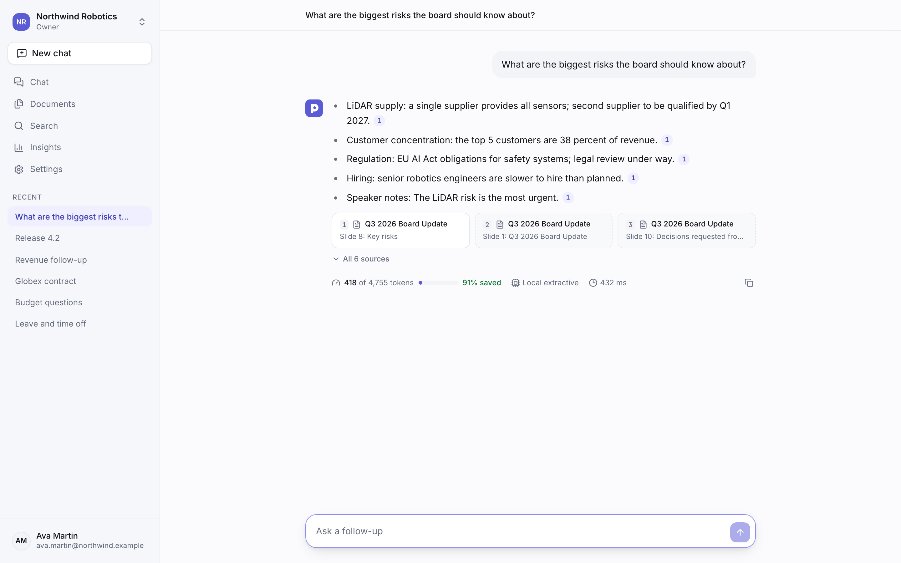<br><sub><b>Cited answers.</b> Every sentence links to its source; the meter shows the tokens saved.</sub></td>
    <td width="50%">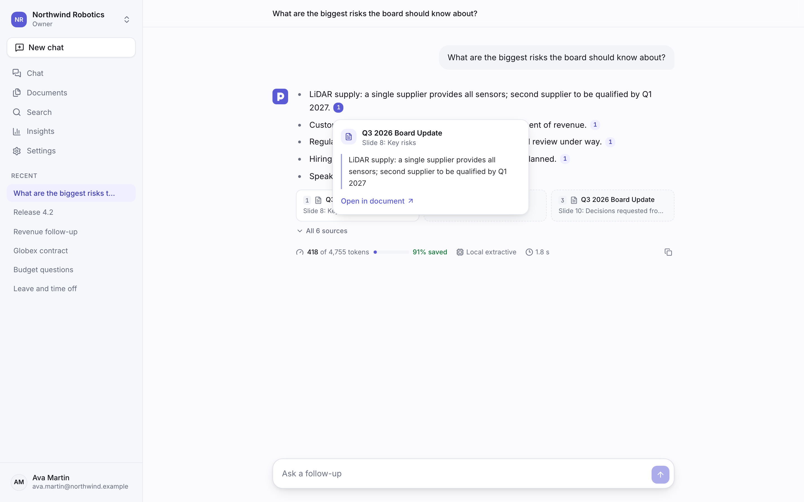<br><sub><b>Citation preview.</b> Click a citation to read the supporting sentence.</sub></td>
  </tr>
  <tr>
    <td>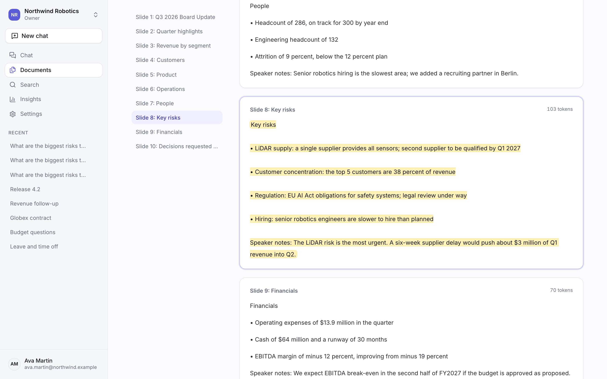<br><sub><b>Document viewer.</b> Opens at the cited passage, highlighted in its section.</sub></td>
    <td>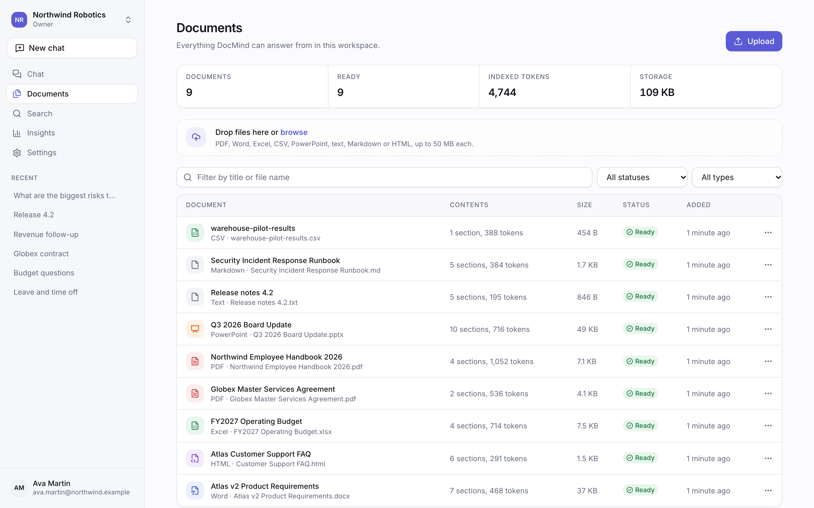<br><sub><b>Library.</b> Upload by drag and drop; status, sections and tokens per file.</sub></td>
  </tr>
  <tr>
    <td>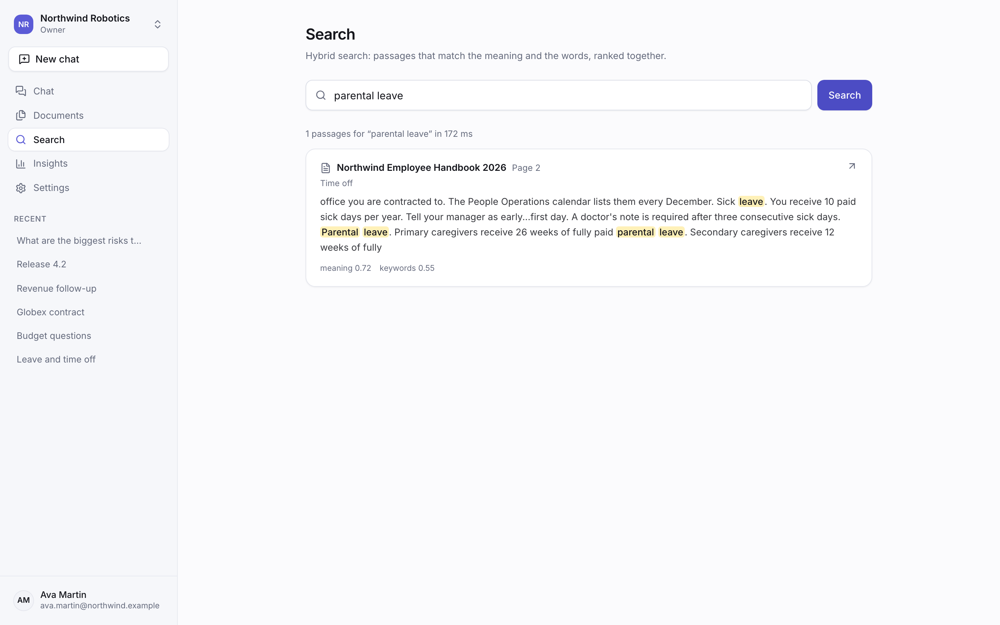<br><sub><b>Search.</b> Meaning and keywords ranked together, with both scores shown.</sub></td>
    <td>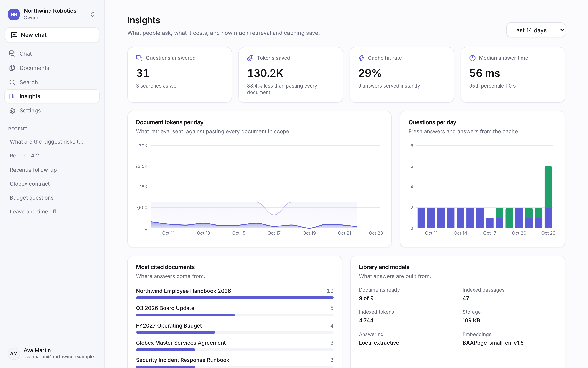<br><sub><b>Insights.</b> Questions, tokens saved, cache hit rate and the most-cited files.</sub></td>
  </tr>
  <tr>
    <td>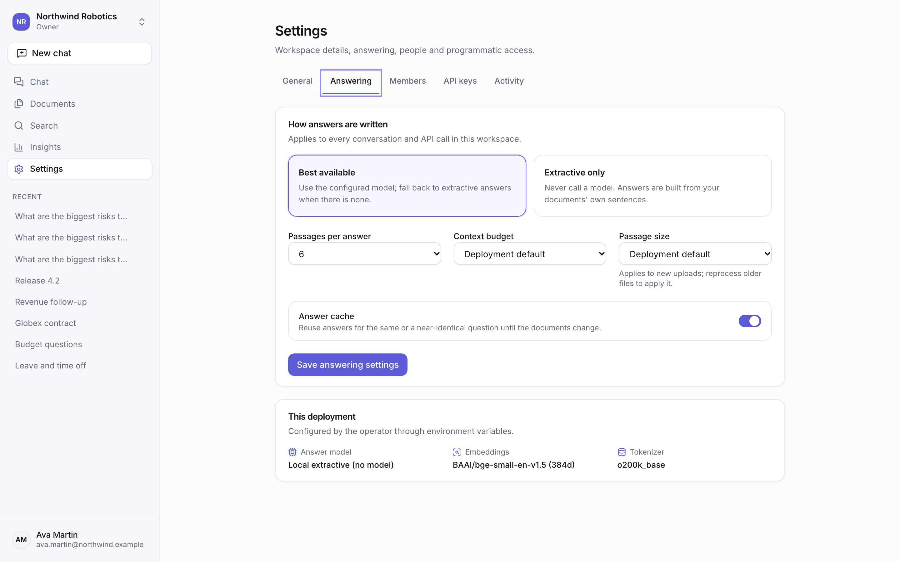<br><sub><b>Answering settings.</b> Per-workspace mode, passages, budget, chunking and cache.</sub></td>
    <td>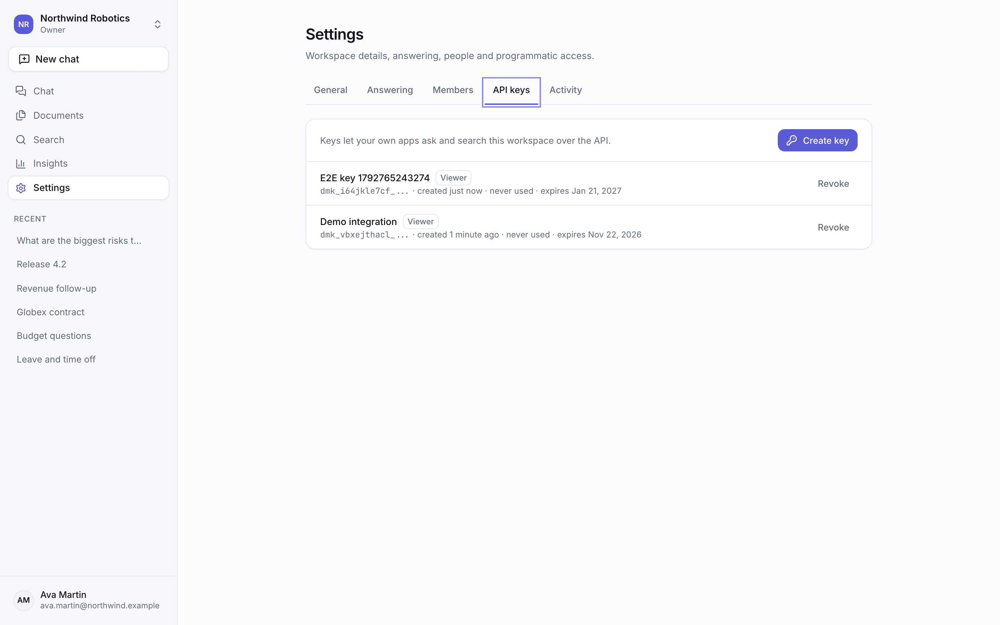<br><sub><b>API keys.</b> Workspace-scoped keys for your own apps, shown once and stored hashed.</sub></td>
  </tr>
  <tr>
    <td>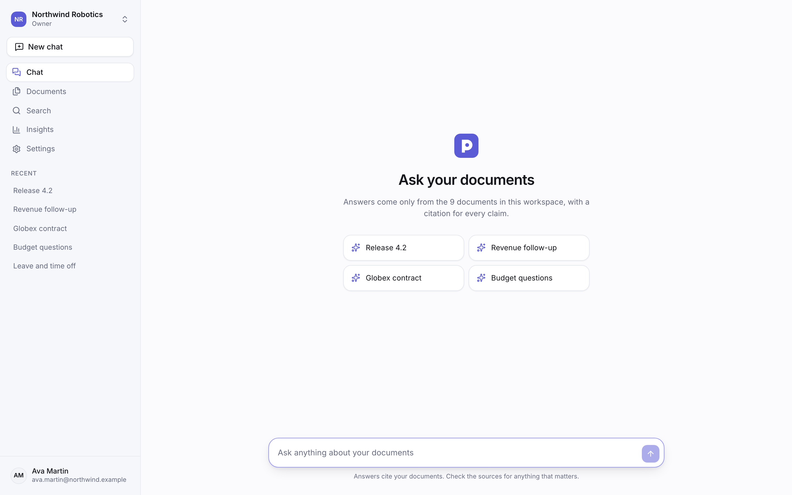<br><sub><b>New chat.</b> Start from a suggestion, or scope a chat to one document from its page.</sub></td>
    <td>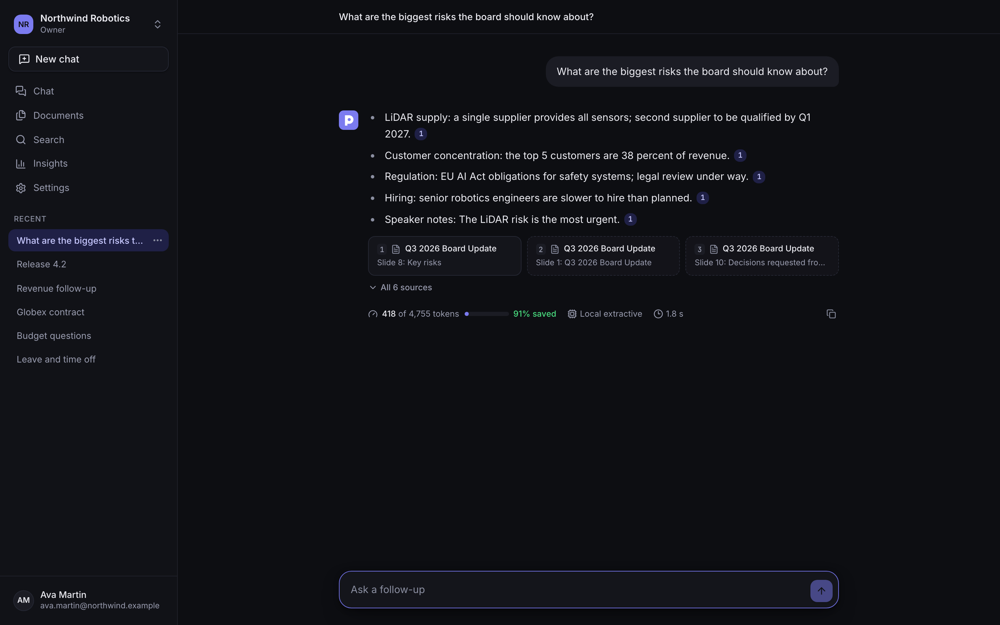<br><sub><b>Dark theme.</b> Follows the system setting, switchable from the account menu.</sub></td>
  </tr>
</table>

## ✨ Features

| Area | What you get |
| --- | --- |
| **Ingestion** | Drag and drop up to 20 files at a time; type sniffing from content, not names; PDF layout-aware text with table recovery, Word headings and tables, every sheet of a workbook as records, slides with notes, Markdown and HTML structure; Office files checked against decompression bombs before parsing; duplicate detection by content hash |
| **Indexing** | Structure-aware chunking that keeps headings with their text, contextual embeddings (title and heading included), local `bge-small-en-v1.5` embeddings with no download at run time, re-indexing per document or workspace |
| **Retrieval** | Vector search on an HNSW index with iterative scans (filters never starve results), OR-of-terms full text ranked by cover density, reciprocal rank fusion, MMR diversity, token-budget packing, scoping to chosen documents |
| **Answers** | Streamed over server-sent events; the extractive answerer handles facts, lists, table lookups and superlatives ("which pilot had the best pick rate") offline; Ollama and OpenAI-compatible models with a prompt that fences sources as data; follow-up questions rewritten from the conversation |
| **Citations** | Markers verified against the sources actually given (no dead links), the supporting sentence for each, and a viewer that opens the passage highlighted |
| **Caching** | Exact match in Valkey and semantic match in pgvector, both keyed by the workspace's library version, its document scope and the answerer's version, so a new upload never serves a stale answer |
| **Workspaces** | Owners, editors and viewers; add people by email (an account is created with a one-time password); per-workspace answering and chunking settings; activity log of every change |
| **API** | Everything the web app does, over a documented REST API; workspace API keys with viewer or editor rights and expiry; one-off questions and streaming for integrations |
| **Insights** | Questions per day, tokens sent against the paste-everything baseline, cache hit rate, latency percentiles and the most-cited documents |
| **Operations** | Health and readiness probes, Prometheus metrics, structured JSON logs with request ids, a worker that survives restarts (visibility heartbeats, retries with back-off, dead-letter queue, a reaper for lost jobs) |

## 🏗️ Architecture

<p align="center">
  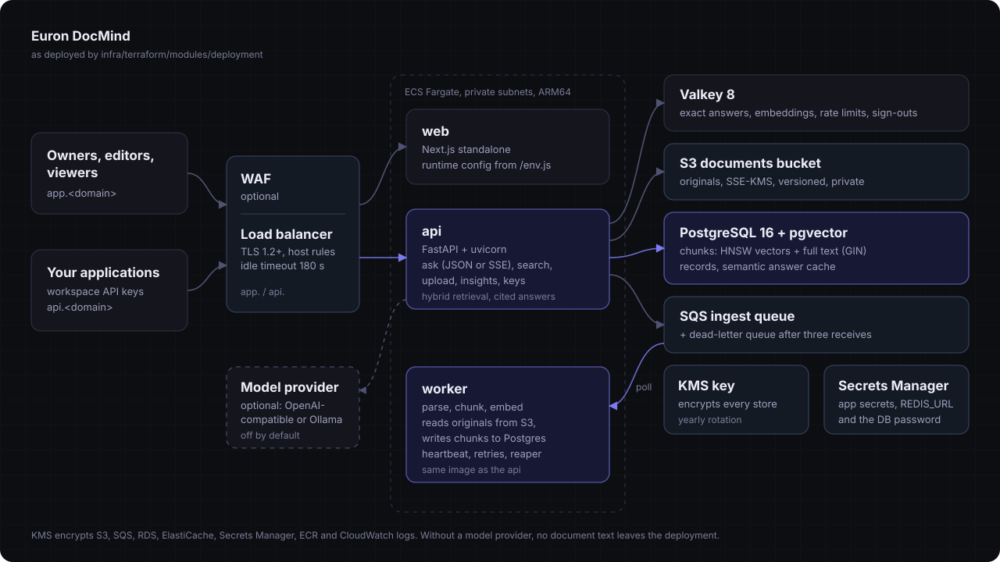
</p>

Three services run on ECS Fargate behind one Application Load Balancer:

- **web** (`app.<domain>`): the Next.js app. One image for every environment; it reads the
  API address at run time from `/env.js`.
- **api** (`api.<domain>`): the FastAPI service: auth, workspaces, the library, chat,
  search, insights and API keys. Uploads are stored in S3 and announced on SQS.
- **worker**: takes documents from SQS, parses, chunks and embeds them into Postgres, and
  extends each message's visibility while it works, so a slow file is never processed twice.

[HLD](docs/architecture/HLD.md) · [LLD](docs/architecture/LLD.md)

### Life of a question

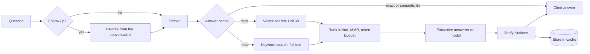

The API layers each have one job:

| Layer | Folder | Job |
| --- | --- | --- |
| Routes | `apps/api/src/docmind/api/routes/` | URL, auth dependency, role check, nothing else |
| Services | `apps/api/src/docmind/services/` | Business rules, transactions, cache invalidation, audit |
| Repositories | `apps/api/src/docmind/repositories/` | The only database access; every query is scoped to a workspace |
| AI | `apps/api/src/docmind/ai/` | Embeddings, retrieval maths, the extractive answerer, prompts, citations, model clients |
| Ingestion | `apps/api/src/docmind/ingestion/` | Type sniffing, archive limits, one parser per format, the chunker |

### From upload to index

```mermaid
sequenceDiagram
  participant B as Browser
  participant A as API
  participant S as S3 (SSE-KMS)
  participant Q as SQS
  participant W as Worker
  participant P as Postgres + pgvector
  B->>A: POST /documents (files)
  A->>A: sniff type, check limits, hash
  A->>S: store the original
  A->>P: document row (queued)
  A->>Q: message: workspace id, document id
  A-->>B: 201 created
  W->>Q: receive (long poll), heartbeat visibility
  W->>S: read the original
  W->>W: parse, chunk, embed
  W->>P: sections, chunks, vectors; library version + 1
  W->>Q: delete the message
```

A file that cannot be parsed fails once with a readable reason. Any other error is retried
with growing back-off; after three attempts SQS moves the message to the dead-letter queue
and the document is marked failed. Read more: [data model](docs/architecture/data-model.md) ·
[security](docs/architecture/security.md) · [threat model](docs/architecture/threat-model.md)

## 🧰 Tech stack

| Layer | Choice | Why |
| --- | --- | --- |
| API | Python 3.12, FastAPI, Pydantic v2, SQLAlchemy 2 (async), Alembic | Typed end to end, native server-sent events, one process model for the API and the worker |
| Search | PostgreSQL 16 with pgvector (HNSW) and full text | Vectors, keywords and the data they describe in one transactional store ([ADR 0001](docs/architecture/adr/0001-postgres-pgvector-for-vectors-and-full-text.md)) |
| Embeddings | fastembed, `BAAI/bge-small-en-v1.5`, baked into the image | Fast on a CPU, no download and no API key at run time |
| Cache | Valkey (Redis-compatible) | Exact answer cache, embedding cache, rate limits and signed-out sessions |
| Ingestion | SQS with a dead-letter queue, a dedicated worker | Uploads return at once; failures are retried and never lost ([ADR 0005](docs/architecture/adr/0005-sqs-ingestion-worker.md)) |
| Web | Next.js 16, React 19, Tailwind 4, TanStack Query, Radix primitives | A fast, accessible app with one image for every environment |
| AWS | ECS Fargate (ARM64), ALB, WAF, RDS, ElastiCache, S3, SQS, KMS, Secrets Manager, CloudWatch | Managed building blocks, least-privilege roles |
| Infrastructure as code | Terraform | The same modules build AWS and the local emulator ([ADR 0006](docs/architecture/adr/0006-floci-for-local-aws.md)) |
| Local AWS | Floci emulator | S3, SQS, KMS and Secrets Manager on a laptop |
| Tests | pytest, Vitest, Playwright | Unit, integration against real Postgres, Valkey and emulated AWS, browser end-to-end and QA |

## 📋 Prerequisites

| Tool | Version | Used for |
| --- | --- | --- |
| [Docker](https://docs.docker.com/get-docker/) with Compose v2 | 24+ | The local stack (about 2.5 GB of images) |
| [uv](https://docs.astral.sh/uv/) | 0.13+ | The API's Python environment, outside Docker |
| [Node.js](https://nodejs.org/) | 22 LTS | The web app and the browser tests, outside Docker |
| [pnpm](https://pnpm.io/) | 9 (`corepack enable`) | The JavaScript workspace |
| [Terraform](https://developer.hashicorp.com/terraform/install) | 1.10+ | Only for deploying to AWS (local runs use a pinned container) |
| [AWS CLI](https://aws.amazon.com/cli/) | 2 | Only for deploying to AWS |

Free local ports (each overridable in `deploy/compose/.env`): 3110 (web), 8110 (API), 5451
(Postgres), 6411 (Valkey), 4611 (AWS emulator).

## 🚀 Quickstart

```bash
git clone https://github.com/euron-sde-team/euron-doc-mind.git
cd euron-doc-mind

make up      # build and start everything; Terraform provisions the AWS emulator first
make demo    # three people, two workspaces, nine sample documents, two weeks of questions
```

| Open | As |
| --- | --- |
| http://localhost:3110 | `ava.martin@northwind.example` (owner of Northwind Robotics), `leo.chen@northwind.example` (editor) or `maya.patel@northwind.example` (viewer) |
| http://localhost:8110/docs | The interactive API reference |

The password for every demo account is printed by `make demo` (it is generated by `make env`
and stored in `deploy/compose/.env`), together with a ready-to-run `curl` and a demo API key.
`make down` stops everything and deletes the data.

To use a model instead of the extractive answerer, set `DOCMIND_LLM_PROVIDER=ollama` and
`DOCMIND_LLM_MODEL=llama3.2` (Ollama running on your machine) or `openai` with
`DOCMIND_LLM_BASE_URL` and `DOCMIND_LLM_API_KEY` in `deploy/compose/.env`, then `make up`.

[Full local guide](docs/guides/quickstart-local.md) ·
[Guided walkthrough](docs/guides/walkthrough.md) ·
[Troubleshooting](docs/guides/troubleshooting.md)

## 🧭 Explore the repository

```text
euron-doc-mind/
├── apps/
│   ├── api/                     FastAPI service, ingestion worker and CLI (one package)
│   │   ├── src/docmind/
│   │   │   ├── api/                 routes and request dependencies
│   │   │   ├── services/            business rules: auth, workspaces, documents, chat, cache
│   │   │   ├── repositories/        all database access, scoped to a workspace
│   │   │   ├── ai/                  embeddings, retrieval, extractive answers, prompts, citations
│   │   │   ├── ingestion/           sniffing, archive limits, parsers, chunker
│   │   │   ├── integrations/        S3, SQS, Secrets Manager
│   │   │   ├── models/ schemas/     tables and API shapes
│   │   │   ├── db/ migrations/      engine, sessions, advisory-locked migrations
│   │   │   ├── core/                config, errors, logging, security, rate limits, metrics
│   │   │   ├── worker.py            the SQS worker
│   │   │   └── cli.py               migrate, users, demo seed, reindex, OpenAPI export
│   │   └── tests/                   unit and integration suites
│   └── web/                     Next.js app: chat, library, viewer, search, insights, settings
├── samples/                     the nine demo documents (generated by scripts/samples)
├── infra/
│   ├── terraform/               modules + envs (local-floci, aws-dev, aws-prod)
│   └── docker/                  api and web images
├── deploy/compose/              the local stack (Floci or real AWS overlay)
├── e2e/                         Playwright: journeys, the QA crawl, screenshots and the tour
├── docs/                        architecture, ADRs, guides, OpenAPI
└── scripts/                     deploy, one-off tasks, local env, sanitization check
```

**Where to start reading:**

| To understand | Read |
| --- | --- |
| How a question becomes a cited answer | `services/chat.py`, then `services/retrieval.py`, `ai/extractive.py` and `ai/citations.py` |
| How a file becomes searchable | `services/documents.py` (upload), `services/ingestion.py` (worker side), `ingestion/parsers/` and `ingestion/chunker.py` |
| How the cache stays correct | `services/answer_cache.py`, then `tests/integration/test_cache.py` |
| How workspaces are isolated | `services/workspaces.py` (`resolve`) and `repositories/`, then `tests/integration/test_access.py` |
| How the worker survives failures | `worker.py`, then `tests/integration/test_worker.py` |
| How it deploys | `infra/terraform/modules/deployment/main.tf`, then `scripts/aws-deploy.sh` |

Paths in the first column's answers are under `apps/api/src/docmind/` unless they start with
`tests/`, `infra/` or `scripts/`. The [walkthrough](docs/guides/walkthrough.md) follows one
question from the composer to the cited answer through the code.

## 🔌 API

The [OpenAPI reference](docs/api/openapi.json) is exported from the application itself
(`make openapi`), so it always matches the code, and the running API serves it interactively
at `/docs`. Use a workspace API key from your own code:

```bash
curl -s localhost:8110/api/v1/workspaces/northwind-robotics/ask \
  -H "authorization: Bearer $DOCMIND_API_KEY" -H 'content-type: application/json' \
  -d '{"question": "What is the parental leave policy?"}' | jq '.message.content, .message.citations[0]'
```

`/ask/stream` returns the same answer as server-sent events (`sources`, `delta`, `done`).
Errors always have the shape `{"error": {"code", "message", "request_id"}}` and every response
carries an `X-Request-Id` header.

## ⚙️ Configuration

The API reads its configuration from the environment. With `APP_ENV=production` it refuses to
boot, listing every problem at once, unless:

- the session secret and the API key pepper are random, at least 32 characters and different
- cookies are secure and CORS names the web app's origins
- files go to S3 and ingestion goes through SQS, with no emulator endpoint configured
- a model provider, if set, names its model

The web app reads `API_URL` and `PRODUCT_NAME` at run time from `/env.js`, so one image serves
every environment. Every variable is documented in the
[configuration reference](docs/guides/configuration.md).

## ☁️ Deploy to AWS

```bash
cp infra/terraform/envs/aws-dev/terraform.tfvars.example infra/terraform/envs/aws-dev/terraform.tfvars
# set name_prefix, domain and route53_zone_id

make aws-deploy ENV=aws-dev       # registries, images, infrastructure, rollout
make aws-cli ENV=aws-dev ARGS="user create --email you@example.com --name 'You' --admin"
```

`aws-deploy` runs four steps:

1. Create the image registries.
2. Build and push the API and web images for ARM64, tagged with the git commit.
3. Apply the rest of the infrastructure.
4. Wait for the API, worker and web services to stabilise.

Migrations run when the API boots, under an advisory lock. The database password never
appears in a task definition: the API and the worker read it from the RDS-managed secret for
each new connection, so a rotation needs no redeploy.

| | aws-dev | aws-prod |
| --- | --- | --- |
| Availability zones | 2, one NAT | 3, NAT per zone, VPC interface endpoints |
| Database | single-AZ, 3-day backups | Multi-AZ, 14-day backups, deletion protection |
| Cache | one Valkey node | primary and replica |
| Edge | load balancer | load balancer with AWS WAF managed rules and rate limiting |
| Scaling | API 1 to 2, worker 1 to 2, web 1 to 2 | API 2 to 6, worker 2 to 8, web 2 to 6 |
| Logs | 14 days | 365 days, KMS-encrypted |

[Deployment guide](docs/guides/deploy-aws.md)

## 🔐 Security model

| Concern | How it is handled |
| --- | --- |
| Workspace isolation | Every query is scoped to the caller's workspace; non-members get 404, not 403; an integration sweep calls every workspace endpoint as an outsider |
| Sessions | argon2id passwords, signed sessions with a per-user version (a password change signs out every other session) and a revocation list for sign-out |
| Cookies and CSRF | HttpOnly, SameSite=Lax cookies; any write with a cookie must come from the web app's origin |
| API keys | `dmk_` keys scoped to one workspace and role, shown once, stored as a peppered HMAC, revocable and expiring |
| Documents | Original files in a private S3 bucket with SSE-KMS; type sniffed from content; archive size and ratio limits; downloads only through the API after a membership check |
| Prompt injection | Sources are fenced as quoted data and the model is told to ignore instructions inside them; citations are verified against what the model was given. This narrows injection, it is not a boundary |
| HTTP | Security headers, CORS allowlist, request size limits, rate limits on sign-in, chat and uploads, no internal detail in 500s |
| Infrastructure | Private subnets, TLS everywhere, KMS for S3, SQS, logs and secrets, least-privilege task roles, checkov with justified exceptions only |

Report vulnerabilities privately: see [SECURITY.md](SECURITY.md).

## 🧪 Testing

| Suite | What it proves | Run |
| --- | --- | --- |
| Unit (135) | Parsers, chunker, retrieval maths, the extractive answerer, citations, prompts, config guards, security, frontend logic | `make test` |
| Integration (41) | The real API against Postgres with pgvector, Valkey and the AWS emulator: grounded answers, both cache levels, the library, an isolation sweep, roles, keys, sessions, the SQS worker, migrations | `make test-integration` |
| Browser (14) | Sign-in, cited answers and the viewer, follow-ups, uploads, search, insights, members and API keys | `make e2e` |
| QA crawl | Every page at desktop and mobile widths: no console errors, failed requests, broken links or serious accessibility violations | `make qa` |
| Infrastructure | `terraform validate` (3 environments), tflint, checkov | `make tf-validate tf-lint tf-security` |

[Testing guide](docs/guides/testing.md)

## 📖 Documentation

| Architecture | Guides |
| --- | --- |
| [High-level design](docs/architecture/HLD.md) | [Quickstart (local)](docs/guides/quickstart-local.md) |
| [Low-level design](docs/architecture/LLD.md) | [Guided walkthrough](docs/guides/walkthrough.md) |
| [Data model](docs/architecture/data-model.md) | [Configuration reference](docs/guides/configuration.md) |
| [Security](docs/architecture/security.md) | [Deploy to AWS](docs/guides/deploy-aws.md) |
| [Threat model](docs/architecture/threat-model.md) | [Testing](docs/guides/testing.md) |
| [Decision records](docs/architecture/adr/) | [Troubleshooting](docs/guides/troubleshooting.md) |
| [API reference (OpenAPI)](docs/api/openapi.json) | [Operations](docs/guides/operations.md) · [API guide](docs/api/README.md) |

## 🗺️ Roadmap

- OCR for scanned PDFs and images
- Connectors that sync folders from Google Drive, SharePoint and S3 prefixes
- SSO (SAML and OIDC) for workspaces
- Answer feedback (helpful or not) feeding retrieval evaluation
- Per-document access rules inside a workspace

Have an idea? [Open a feature request](https://github.com/euron-sde-team/euron-doc-mind/issues/new/choose).

## ❓ FAQ

<details>
<summary><b>Do I need an OpenAI key or a GPU?</b></summary>

No. The default answerer composes answers from your documents' own sentences, and the
embedding model runs on a CPU inside the image. Point DocMind at Ollama or any
OpenAI-compatible API when you want written prose instead.
</details>

<details>
<summary><b>Does my data leave my infrastructure?</b></summary>

Not by default: parsing, embeddings, search and the extractive answerer all run in your
deployment. With a hosted model, only the question and the few passages selected for it are
sent, never whole files.
</details>

<details>
<summary><b>How does it avoid making things up?</b></summary>

The extractive answerer can only repeat sentences that exist in your documents, and it says
when nothing covers the question. With a model, the prompt allows only the numbered sources,
and every citation marker is checked against the sources the model was given.
</details>

<details>
<summary><b>What happens to cached answers when I upload a new version of a file?</b></summary>

Every finished upload bumps the workspace's library version, which is part of every cache key,
so later questions are answered fresh from the new library.
</details>

<details>
<summary><b>Can it run outside AWS?</b></summary>

Yes. The API also supports local disk storage and an in-process ingestion queue, so it runs
anywhere with Postgres (with pgvector) and Redis or Valkey. The Terraform targets AWS.
</details>

## 🤝 Contributing, security and license

Contributions are welcome: read [CONTRIBUTING.md](CONTRIBUTING.md) and the
[code of conduct](CODE_OF_CONDUCT.md). Report security issues privately as described in
[SECURITY.md](SECURITY.md).

Released under the [MIT License](LICENSE). Copyright (c) 2026 ENGAGESPHERE TECHNOLOGY
PRIVATE LIMITED and the Euron DocMind contributors.

<p align="center">
  If Euron DocMind saves you time, <b><a href="https://github.com/euron-sde-team/euron-doc-mind/stargazers">⭐ star the repository</a></b>.
</p>
