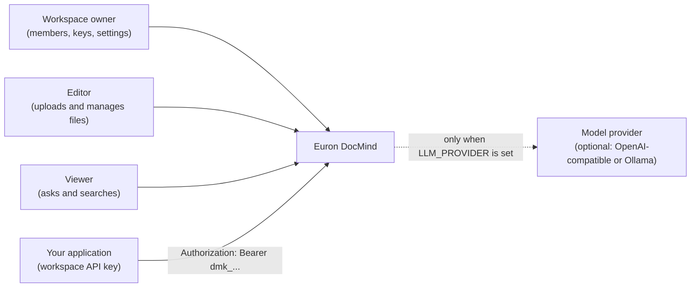
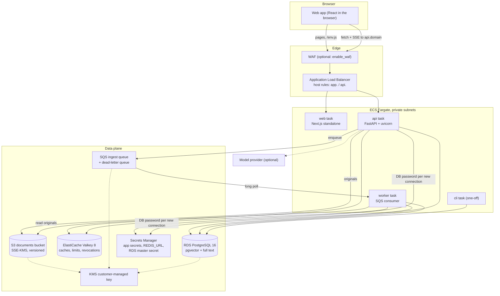
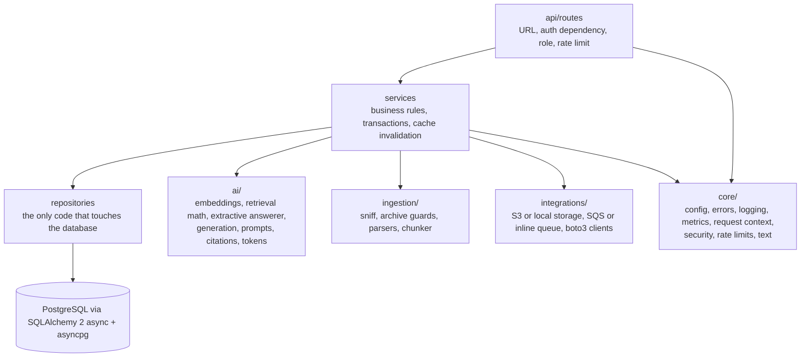
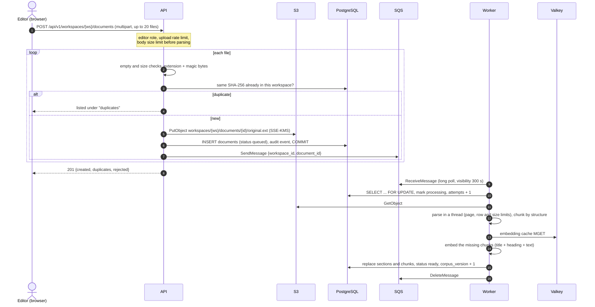
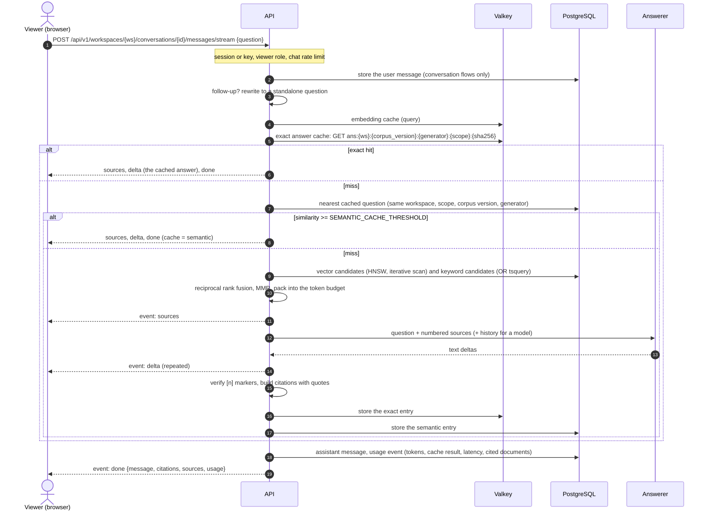
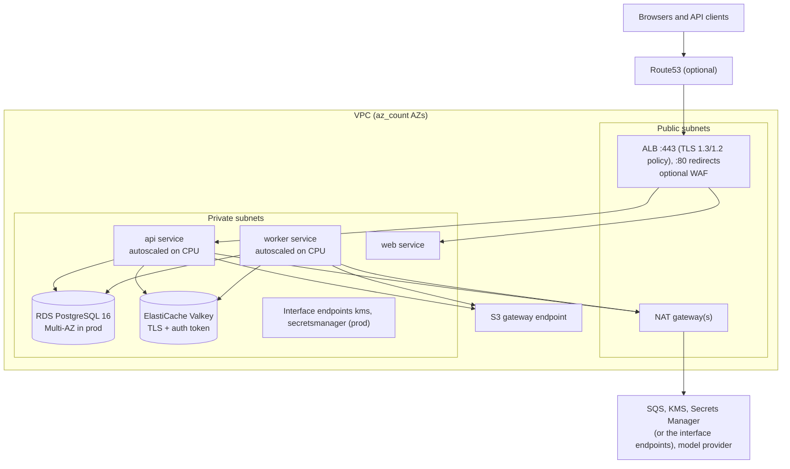

# High-level design

Euron DocMind is private, cited chat over your own documents. A team uploads PDFs, Word
files, spreadsheets, slide decks, Markdown, HTML and plain text into a workspace; DocMind
parses and indexes them on its own infrastructure and answers questions with citations
that open the exact passage they came from. It is an open-source project from ENGAGESPHERE
TECHNOLOGY PRIVATE LIMITED.

This document describes the system as it is built: what runs, where data lives, how a
request travels and how the pieces are deployed. Deeper topics have their own pages:

| Topic | Page |
| --- | --- |
| Modules, algorithms and code paths | [LLD.md](LLD.md) |
| Tables, indexes and the storage model | [data-model.md](data-model.md) |
| Authentication, authorisation, hardening | [security.md](security.md) |
| STRIDE analysis and residual risks | [threat-model.md](threat-model.md) |
| Decisions and their trade-offs | [adr/](adr/) |

## 1. Product

| Capability | What it does |
| --- | --- |
| Upload and index | Up to 20 files per request, each up to `MAX_UPLOAD_MB` (50 MB by default): PDF, `.docx`, `.xlsx`, CSV, `.pptx`, `.txt`, Markdown and HTML. Files are checked by extension and magic bytes, deduplicated per workspace by SHA-256, stored encrypted, then parsed, chunked and embedded by the worker |
| Ask | Questions are answered from the workspace's documents only, streamed as server-sent events or returned as JSON. Every factual sentence carries a numbered citation that resolves to a document, a location (page, slide, sheet or section) and character offsets |
| Follow-ups | Conversations keep their history; follow-up questions ("how long does it last?") are rewritten into standalone questions before retrieval |
| Scope | A question or a whole conversation can be limited to selected documents |
| Search | Hybrid search (meaning plus keywords) with highlighted snippets, without generating an answer |
| Answer cache | Repeated questions are answered from an exact cache in Valkey; paraphrases from a semantic cache in pgvector. Both reset when the corpus changes |
| Insights | Questions per day, tokens sent to the answerer against the paste-everything baseline, tokens saved, cache hit rate, latency percentiles and the most cited documents |
| Workspaces | Owner, editor and viewer roles, members added by email (with a temporary password for new accounts), per-workspace answering settings and an audit trail |
| API keys | Workspace-scoped `dmk_...` keys with viewer or editor access, optional expiry, revocable, for calling the API from your own apps |

Answers are produced by the offline extractive answerer unless a model is configured: any
OpenAI-compatible endpoint or a local Ollama server. Embeddings run in process with
fastembed (`BAAI/bge-small-en-v1.5`, 384 dimensions, ONNX Runtime), so a default
deployment never sends document text to a third party.

## 2. System context

The first account created on a deployment is flagged as the instance administrator
(`users.is_admin`). Every permission inside a workspace comes from the member's role in
that workspace; non-members get `404 not_found` for anything in it, never `403`, so the
existence of a workspace is not disclosed.

## 3. Containers

The repository builds two images. The API image also runs the ingestion worker and the
operator CLI with a different command.

| Container | Source | Image | Listens | Role |
| --- | --- | --- | --- | --- |
| Web app | `apps/web` (Next.js 16, standalone) | `infra/docker/web.Dockerfile` | 8080 | Chat, library, document viewer, search, insights and settings. Serves `/env.js` with runtime configuration |
| API | `apps/api` (FastAPI, uvicorn) | `infra/docker/api.Dockerfile` | 8080 | REST and SSE API under `/api/v1`, health and metrics |
| Worker | `docmind.worker` | API image, `python -m docmind.worker` | metrics only (`WORKER_METRICS_PORT`) | Consumes the SQS ingestion queue: parse, chunk, embed, index |
| CLI (one-off) | `docmind.cli` | API image, `docmind ...` | none | `migrate`, `user create`, `demo seed`, `reindex`, `openapi` |

The embedding model and the tokenizer are baked into the API image at build time, so a
running container never downloads anything to index or answer.

The web image is environment-agnostic: the API URL and the product name are read when
`/env.js` is requested, never inlined at build time, so one image runs in every
environment ([ADR 0007](adr/0007-one-image-runtime-config.md)). The browser calls the API
host directly with `credentials: "include"`, so the API allows exactly the origins in
`CORS_ORIGINS` and checks the `Origin` of every cookie-authenticated write.

## 4. Inside the API

The API is layered, and each layer calls only the one below it.

| Folder | Responsibility |
| --- | --- |
| `core/` | `Settings` (pydantic-settings, validated once) and the production guard, the error envelope, structured logging with redaction, Prometheus metrics, the request-id and body-size middlewares, passwords, sessions and API keys, the Redis rate limiter, text utilities |
| `api/` | `deps.py` resolves the principal (session cookie, session bearer token or API key), the workspace and the caller's role; `routes/` holds one router per area |
| `services/` | `auth`, `workspaces`, `documents`, `ingestion`, `retrieval`, `answer_cache`, `chat`, `search`, `insights`, `api_keys`, `users`, `audit`, and the dependency `container` |
| `repositories/` | One repository per aggregate plus `search.py`, the static SQL for vector, keyword, hydration and headline queries |
| `ai/` | Pure or provider-facing AI code: embedding providers and their cache, RRF, MMR and context packing, the extractive answerer, model clients, prompts, citation extraction, token counting |
| `ingestion/` | File type detection, Office archive guards, one parser per format, the structure-aware chunker |
| `integrations/` | Storage (S3 with SSE-KMS, or a local directory), the job queue (SQS, or in process), boto3 client factories |
| `db/` | Declarative base with naming conventions, the async engine (pgvector codec, Secrets Manager password), the advisory-locked migration runner |
| `migrations/` | Alembic revisions, shipped inside the package |
| `demo/` | `make demo`: accounts, workspaces, the sample documents and a few weeks of questions |

### Boot and shutdown

1. `create_app()` configures logging and, with `APP_ENV=production`, refuses to start if
   `Settings.production_problems()` reports anything: development secrets, equal session
   secret and pepper, insecure cookies, open CORS, local storage, the inline queue, an
   emulator endpoint, the test-only hash embedder, or a model provider without a model.
2. In the lifespan, with `MIGRATE_ON_BOOT=true`, migrations run under a Postgres advisory
   lock, so several tasks starting together are safe.
3. The dependency container is built: database engine, Valkey client, storage, queue,
   embedder (wrapped in the embedding cache), token counter, generator and rate limiter.
   The embedding model is loaded in the background so the first question is not slow.
4. On `SIGTERM`, uvicorn stops accepting connections and drains requests for up to 20
   seconds (`--timeout-graceful-shutdown 20` in the image); the inline queue, when used, is
   drained; the container closes its clients.

The worker handles `SIGTERM` itself: it stops receiving, lets in-flight documents finish for
up to 120 seconds, then exits. A message it did not finish becomes visible again and is
picked up by another worker.

### Health, readiness and metrics

| Path | Purpose | Behaviour |
| --- | --- | --- |
| `GET /livez` | Liveness and the load balancer health check | Always `{"status": "ok"}` while the process serves |
| `GET /readyz` | Readiness | Pings the database, Valkey, storage and the queue; `503` with the failing check named when any is down |
| `GET /metrics` | Prometheus | HTTP counters and latency by route template, ingestion counts and duration, retrieval and generation latency, tokens by kind, answer and embedding cache results |
| `GET /api/v1/system/info` | Capabilities | Product name, version, answerer, embedding model and width, tokenizer, upload limit, accepted extensions, whether sign-up is open and whether the deployment still needs its first account |

## 5. Request flows

### Upload to index

The browser polls the library every two seconds while any document is `queued` or
`processing`. The heartbeat extends the message's visibility every 150 seconds while a
document is processed, so a slow parse is never handed to a second worker. A file that
cannot be parsed fails at once with a message the user can act on ("This PDF is
password-protected"); an unexpected error is retried with growing back-off and the third
attempt marks the document failed. A message received three times without ever being
completed (a worker that keeps crashing on it) is moved by SQS to the dead-letter queue.

### Ask to cited answer

The same flow serves the JSON endpoints (`/ask`, `/conversations/{id}/messages`), which
collect the events and return the final message, keeping the status code of any error.
Only answers that carry at least one citation and are not "not found" are cached.

### Search

`POST /api/v1/workspaces/{ws}/search` runs the same two candidate searches and fusion as
answering (without MMR or packing), asks Postgres for `ts_headline` snippets in which
matches are wrapped in the control characters U+0001 and U+0002 instead of HTML, and records
a `search` usage event. The client splits on those characters and renders text nodes, so
document content is never interpreted as markup.

## 6. Data stores

| Store | What it holds | Notes |
| --- | --- | --- |
| PostgreSQL 16 with pgvector | Every record: 12 tables in one migration (`0001_initial_schema`), plus `alembic_version` | Chunk embeddings in an HNSW index (cosine), full text in a generated `tsvector` column with a GIN index; the semantic answer cache. See [data-model.md](data-model.md) |
| Valkey 8 | Exact answer cache, embedding cache, rate-limit counters, signed-out session ids, API key last-used throttle, the reaper's leader lock, a 30-second insights cache | Everything in it can be rebuilt. Eviction must not drop revoked session ids, so no eviction policy is set locally |
| S3 documents bucket | The original files at `workspaces/{workspace_id}/documents/{document_id}/original.{ext}` | Private, SSE-KMS, TLS-only policy, versioned on AWS. `STORAGE_BACKEND=local` writes to `STORAGE_DIR` instead (development) |
| SQS | One message per document to index, carrying ids only | Dead-letter queue after three receives; KMS-encrypted |
| KMS | Encrypts the bucket, the queues, RDS storage and Performance Insights, Secrets Manager, ECR and CloudWatch log groups | One customer-managed key per deployment, yearly rotation |
| Secrets Manager | `<name_prefix>/app` (`SESSION_SECRET`, `API_KEY_PEPPER`), the Valkey `REDIS_URL` with its auth token, the RDS-managed master secret, optionally `LLM_API_KEY` | App secrets are injected at task start; the database password is read per new connection |

## 7. Background work

| Work | Where | Behaviour |
| --- | --- | --- |
| Ingestion | Worker | Long polls SQS (10-second waits) for up to `WORKER_CONCURRENCY` documents at a time; visibility heartbeat; retry with back-off; dead-letter queue |
| Stale document reaper | Worker, one at a time | Every 60 seconds, the worker that wins `SET lock:reaper NX` re-sends documents unfinished for `STALE_PROCESSING_MINUTES`, but only re-sends queued ones while the queue is empty (with a backlog their message is still waiting); documents out of attempts are marked failed |
| Answer cache expiry | Worker, with the reaper | Deletes semantic cache rows past `expires_at` (Valkey expires exact entries by TTL) |
| Inline ingestion | API, development only | `QUEUE_BACKEND=inline` runs the same `IngestionService.process` as a background task in the API process |

## 8. Deployment topology (AWS)

`infra/terraform/modules/deployment` composes one complete environment from the modules
`network`, `kms`, `secrets`, `database`, `storage`, `queue`, `cache`, `ecr`, `edge`,
`service` (used four times: api, worker, web and the one-off cli task) and
`observability`. `envs/aws-dev` and `envs/aws-prod` call it with different sizes and
safety switches; `envs/local-floci` applies the `kms`, `storage`, `queue` and `secrets`
modules to the local emulator.

| Concern | Implementation |
| --- | --- |
| Hostnames | `app.<domain>` (web) and `api.<domain>` (API) on one ALB with host-header rules; unknown hosts get a fixed 404 |
| TLS | ACM certificate, DNS-validated through Route53, or an existing `certificate_arn`; `ELBSecurityPolicy-TLS13-1-2-2021-06` |
| Streaming | ALB idle timeout of 180 seconds, so long streamed answers are not cut |
| Tasks | Fargate, ARM64, no public IP, read-only root filesystem with a writable `/tmp`, own security group and IAM roles per service |
| Least privilege | The API role may put, get and delete objects under `workspaces/*` and send to the queue; the worker role may only get objects and consume (and re-send to) the queue; both may read the database secret and use the key only through S3, SQS and Secrets Manager |
| Rollout | Deployment circuit breaker with automatic rollback |
| Scaling | CPU target tracking at 60 percent, per-service minimum and maximum counts |
| WAF | When `enable_waf`: AWS managed common, known-bad-inputs and IP reputation rules (the body size rule counts instead of blocking, because uploads are large), plus a per-IP rate rule (2000 requests per 5 minutes) |
| Observability | Alarms to an SNS topic (optionally emailed) and one CloudWatch dashboard; see [deploy-aws.md](../guides/deploy-aws.md#alarms) |

Sizing differences between `aws-dev` and `aws-prod` are listed in
[deploy-aws.md](../guides/deploy-aws.md#sizing).

## 9. Local topology

`make up` starts the two images (API and worker share one), Postgres with pgvector, Valkey
and the Floci AWS emulator, plus a one-shot Terraform container that provisions the
emulator with the production modules before the API and the worker start. See
[quickstart-local.md](../guides/quickstart-local.md) and
[ADR 0006](adr/0006-floci-for-local-aws.md).

| Service | Host port | Purpose |
| --- | --- | --- |
| web | 3110 | Web app |
| api | 8110 | API (container port 8080); interactive reference at `/docs` |
| worker | none | Ingestion from the emulated SQS queue |
| postgres | 5451 | PostgreSQL 16 with pgvector 0.8 |
| valkey | 6411 | Valkey 8 |
| floci | 4611 | S3, KMS, SQS and Secrets Manager |

## 10. Quality attributes

| Attribute | How the design addresses it |
| --- | --- |
| Privacy | Embeddings and the default answerer run in process; no document text leaves the deployment unless a model provider is configured. Originals are encrypted with the deployment's own key |
| Answer quality | Hybrid retrieval catches both paraphrases (vectors) and exact terms such as product codes (keywords); contextual chunk embeddings; MMR removes near-duplicates; citations are verified against the sources actually given |
| Latency | Exact cache hits cost one Valkey GET; embeddings of repeated text cost one MGET; the HNSW index keeps vector search sub-linear; answers stream from the first token |
| Cost | The token meter shows the context actually sent against the whole-library baseline; caching avoids model calls entirely for repeats and paraphrases |
| Scalability | The API is stateless and scales out with tasks (one process per container); ingestion is buffered by SQS and scales with worker tasks; Postgres is the only stateful tier besides the rebuildable cache |
| Resilience | Duplicate or stale messages are harmless (idempotent processing keyed by document status); the reaper recovers lost messages; poison documents end in the dead-letter queue; rollouts roll back on failed health checks |
| Operability | JSON logs with a request id on every line and response, Prometheus metrics, readiness that names the failing dependency, CloudWatch alarms for errors, backlog and dead letters |
