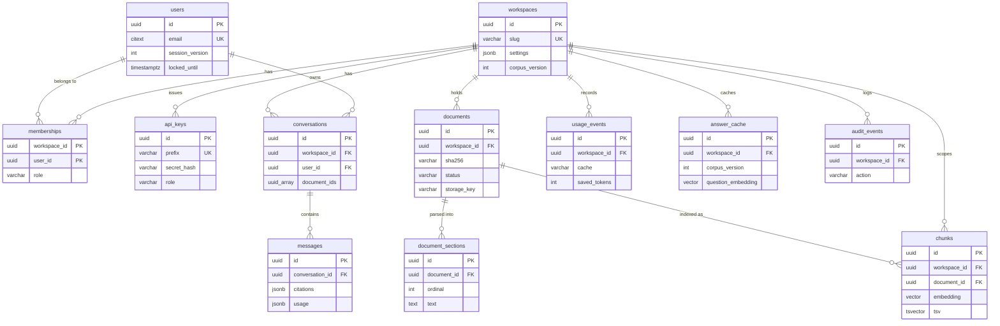

# Data model

The schema is owned by Alembic migrations inside the package
(`apps/api/src/docmind/migrations/versions/`, one revision today:
`0001_initial_schema.py`), applied by `docmind migrate` or on boot with
`MIGRATE_ON_BOOT=true`. The SQLAlchemy models in `apps/api/src/docmind/models/` mirror it.
This page shows the conventions, an entity diagram and every table with its indexes and the
reason each index exists.

## Conventions

| Convention | Detail |
| --- | --- |
| Identifiers | `uuid` primary keys, generated in the application as UUIDv7 (`core/ids.py`): time-ordered, so new rows land at the end of the primary-key index instead of at random pages |
| Timestamps | `timestamptz`, `created_at` and `updated_at` default to `now()`; `updated_at` is set on every update and fetched with `RETURNING` |
| Value sets | Short `text` or `varchar` columns with named `CHECK` constraints instead of Postgres enums, which are cheaper to evolve (`models/enums.py`) |
| Flexible documents | `jsonb` only for data that is read whole and never filtered: workspace settings, citations, sources, usage, audit details, parse warnings |
| Workspace scoping | Every table that holds workspace content has `workspace_id` with an index and `ON DELETE CASCADE`, so deleting a workspace removes its rows in one statement |
| People references | `ON DELETE SET NULL` for authorship columns (`uploaded_by`, `created_by`, actors), so removing an account keeps the content and the audit trail |
| Names | Deterministic constraint and index names from the naming convention in `db/base.py` (`ix_<table>_<columns>`, `uq_...`, `fk_...`, `ck_..._<name>`, `pk_...`) |
| Extensions | `vector` (pgvector 0.8, embeddings and HNSW) and `citext` (case-insensitive email) |
| Embedding width | Fixed per deployment by `EMBEDDING_DIM` (384 for `bge-small-en-v1.5`) when the migration runs. Changing the model means a new migration and `docmind reindex` |

## Entities

## People and access

### `users`

| Column | Type | Notes |
| --- | --- | --- |
| `id` | `uuid` | Primary key |
| `email` | `citext` | Unique, so `Ava@Example.com` and `ava@example.com` are one account; stored lower-cased |
| `name` | `varchar(120)` | Display name |
| `password_hash` | `text` | Argon2id hash in PHC format |
| `is_admin` | `boolean` | Set on the first account of a deployment (and by `docmind user create --admin`) |
| `session_version` | `int` | In every session token; incremented by a password change to end every other session |
| `failed_logins`, `locked_until` | `int`, `timestamptz` | Lockout after eight failures, for 15 minutes |
| `last_login_at` | `timestamptz` | Shown to the person |
| `created_at`, `updated_at` | `timestamptz` | |

### `workspaces`

| Column | Type | Notes |
| --- | --- | --- |
| `id` | `uuid` | Primary key |
| `slug` | `varchar(64)` | Unique; used in URLs (`/w/northwind-robotics`). Derived from the name, with a random suffix on collision |
| `name`, `description` | `varchar(120)`, `text` | |
| `settings` | `jsonb` | `answer_mode` (`auto` or `extractive`), `top_k`, `context_token_budget`, `chunk_tokens`, `chunk_overlap_tokens`, `cache_enabled` (`schemas/workspaces.py`) |
| `corpus_version` | `int` | Incremented whenever the set of ready documents changes; part of every answer-cache key |
| `created_by` | `uuid` | `users`, `SET NULL` |

### `memberships`

| Column | Type | Notes |
| --- | --- | --- |
| `workspace_id`, `user_id` | `uuid` | Composite primary key; both cascade |
| `role` | `varchar(16)` | `CHECK (role IN ('owner', 'editor', 'viewer'))` |
| `created_at` | `timestamptz` | Shown as "joined" |

| Index | Why |
| --- | --- |
| Primary key `(workspace_id, user_id)` | Resolving the caller's role on every workspace request is one index lookup |
| `ix_memberships_user_id` | Listing a person's workspaces (`/auth/me`, the workspace switcher) |

### `api_keys`

| Column | Type | Notes |
| --- | --- | --- |
| `id` | `uuid` | Primary key |
| `workspace_id` | `uuid` | Cascades |
| `created_by` | `uuid` | `SET NULL` |
| `name` | `varchar(80)` | |
| `prefix` | `varchar(16)` | Unique: the public part of `dmk_<prefix>_<secret>`, used to find the row |
| `secret_hash` | `varchar(64)` | HMAC-SHA256 of the secret, keyed with `API_KEY_PEPPER`; the secret itself is never stored |
| `role` | `varchar(16)` | `CHECK (role IN ('editor', 'viewer'))`: keys are never owners |
| `last_used_at`, `expires_at`, `revoked_at` | `timestamptz` | `last_used_at` written at most once a minute |

| Index | Why |
| --- | --- |
| `uq_api_keys_prefix` | Resolving a key on each keyed request |
| `ix_api_keys_workspace_id` | The owner's key list |

## Documents and the index

### `documents`

| Column | Type | Notes |
| --- | --- | --- |
| `id` | `uuid` | Primary key; also part of the storage key |
| `workspace_id` | `uuid` | Cascades |
| `title` | `varchar(300)` | From the filename, replaced by the file's own title metadata when available |
| `filename`, `kind`, `mime_type` | `varchar` | `CHECK (kind IN ('pdf', 'docx', 'xlsx', 'csv', 'pptx', 'txt', 'md', 'html'))` |
| `size_bytes` | `bigint` | |
| `sha256` | `varchar(64)` | Content hash for deduplication |
| `storage_key` | `varchar(400)` | `workspaces/{workspace_id}/documents/{id}/original.{ext}` in the bucket (or under `STORAGE_DIR`) |
| `status` | `varchar(16)` | `CHECK (status IN ('queued', 'processing', 'ready', 'failed'))` |
| `error` | `text` | A user-facing reason when `failed` |
| `warnings` | `jsonb` | Parse warnings, for example skipped pages without text |
| `section_count`, `chunk_count`, `token_count` | `int` | Filled when ready; `token_count` feeds the baseline in the token meter |
| `attempts` | `int` | Processing attempts; three is the limit |
| `uploaded_by` | `uuid` | `SET NULL` |
| `processed_at` | `timestamptz` | When it became ready |

| Index | Why |
| --- | --- |
| `uq_documents_workspace_id_sha256` | The same bytes uploaded twice to a workspace are one document; the upload checks it and the constraint enforces it under concurrency |
| `ix_documents_workspace_id_created_at` | The library, newest first, paginated |
| `ix_documents_unfinished` on `updated_at`, partial `WHERE status IN ('queued', 'processing')` | The stale-document reaper scans only unfinished rows; the index stays tiny however large the library grows |

### `document_sections`

One row per page, slide, sheet or section: the viewer's unit and the citation's target.

| Column | Type | Notes |
| --- | --- | --- |
| `id` | `uuid` | Primary key |
| `document_id` | `uuid` | Cascades |
| `ordinal` | `int` | Position in the document; `UNIQUE (document_id, ordinal)` |
| `kind` | `varchar(16)` | `CHECK (kind IN ('page', 'slide', 'sheet', 'section'))` |
| `label` | `varchar(300)` | `Page 3`, `Slide 4: Risks`, a sheet name, a heading |
| `text` | `text` | The section's full text; chunk offsets point into it |
| `token_count` | `int` | |

### `chunks`

The retrieval unit: an exact slice of one section, with its embedding and its full-text
vector.

| Column | Type | Notes |
| --- | --- | --- |
| `id` | `uuid` | Primary key; cited as `chunk_id` |
| `workspace_id`, `document_id` | `uuid` | Both cascade. `workspace_id` is denormalised so retrieval filters without a join |
| `section_ordinal`, `ordinal` | `int` | The section it belongs to and its order in the document |
| `heading`, `location` | `text`, `varchar(300)` | The heading path (`Benefits > Parental leave`) and the section label |
| `text` | `text` | `section.text[char_start:char_end]` |
| `char_start`, `char_end` | `int` | Offsets into the section's text, used to highlight citations |
| `token_count` | `int` | Used to pack the context budget |
| `content_hash` | `varchar(64)` | SHA-256 of the embedded text (title, heading and chunk) |
| `embedding` | `vector(EMBEDDING_DIM)` | L2-normalised, so cosine similarity is a dot product |
| `tsv` | `tsvector`, generated and stored | `to_tsvector('english', coalesce(heading, '') \|\| ' ' \|\| text)`: headings count for keyword search too |

| Index | Why |
| --- | --- |
| `ix_chunks_embedding_hnsw` (HNSW, `vector_cosine_ops`, `m = 16`, `ef_construction = 64`) | Approximate nearest neighbours for retrieval. Queries set `hnsw.iterative_scan = relaxed_order` so workspace and document filters do not starve the result list |
| `ix_chunks_tsv` (GIN) | Keyword candidates with `tsv @@ query` |
| `ix_chunks_workspace_id` | Workspace filters and counts |
| `ix_chunks_document_id_ordinal` | Replacing a document's chunks on reindex and reading them in order |

## Conversations

### `conversations`

| Column | Type | Notes |
| --- | --- | --- |
| `id` | `uuid` | Primary key |
| `workspace_id`, `user_id` | `uuid` | Both cascade; conversations are private to the person who started them |
| `title` | `varchar(200)` | The first question, until renamed |
| `document_ids` | `uuid[]` | Optional scope for every question in the conversation; `NULL` is the whole workspace |
| `message_count` | `int` | |

| Index | Why |
| --- | --- |
| `ix_conversations_workspace_id_user_id_updated_at` | The sidebar: one person's conversations in one workspace, most recent first |

### `messages`

| Column | Type | Notes |
| --- | --- | --- |
| `id` | `uuid` | Primary key |
| `conversation_id` | `uuid` | Cascades |
| `role` | `varchar(16)` | `CHECK (role IN ('user', 'assistant'))` |
| `content` | `text` | The question, or the answer with its `[n]` markers |
| `citations` | `jsonb` | Verified citations: chunk, document, title, location, section, offsets, quote |
| `sources` | `jsonb` | Every passage the answerer was given, so the sources panel survives a reload |
| `usage` | `jsonb` | Generator, cache result, context, prompt, completion, baseline and saved tokens, latency |

| Index | Why |
| --- | --- |
| `ix_messages_conversation_id_created_at` | Loading a conversation in order, and the recent history for follow-ups |

## Usage, cache and audit

### `usage_events`

One row per answer and per search, the source of the insights page.

| Column | Type | Notes |
| --- | --- | --- |
| `workspace_id` | `uuid` | Cascades |
| `user_id`, `api_key_id` | `uuid` | Who asked; `SET NULL` |
| `kind` | `varchar(16)` | `CHECK (kind IN ('answer', 'search'))` |
| `cache` | `varchar(16)` | `CHECK (cache IN ('miss', 'exact', 'semantic'))` |
| `generator` | `varchar(120)` | `extractive`, `openai:<model>`, `ollama:<model>`, or `search` |
| `context_tokens`, `prompt_tokens`, `completion_tokens`, `baseline_tokens`, `saved_tokens` | `int` | The token meter |
| `latency_ms` | `int` | For the percentiles |
| `cited_document_ids` | `uuid[]` | For the most-cited documents chart |

| Index | Why |
| --- | --- |
| `ix_usage_events_workspace_id_created_at` | Every insights query is one workspace over a time range |

### `answer_cache`

The semantic level of the answer cache (the exact level lives in Valkey).

| Column | Type | Notes |
| --- | --- | --- |
| `workspace_id` | `uuid` | Cascades |
| `scope_hash` | `varchar(64)` | `all`, or a hash of the sorted document ids |
| `corpus_version` | `int` | The workspace's version when the answer was produced |
| `generator` | `varchar(120)` | `label#version`, for example `extractive#2` |
| `question`, `question_embedding` | `text`, `vector(EMBEDDING_DIM)` | The standalone question and its embedding |
| `answer`, `citations`, `usage` | `text`, `jsonb`, `jsonb` | What a hit returns; `usage` also holds the sources and context tokens |
| `hits`, `last_hit_at` | `int`, `timestamptz` | Effectiveness |
| `expires_at` | `timestamptz` | `ANSWER_CACHE_TTL_S` after creation |

| Index | Why |
| --- | --- |
| `ix_answer_cache_lookup` on `(workspace_id, scope_hash, corpus_version, generator)` | Narrows the nearest-question search to the few rows that may legally answer; the distance is computed over that small set, so no vector index is needed |
| `ix_answer_cache_expires_at` | The worker's periodic purge of expired rows |

### `audit_events`

| Column | Type | Notes |
| --- | --- | --- |
| `workspace_id` | `uuid` | Cascades |
| `actor_user_id`, `actor_api_key_id` | `uuid` | `SET NULL`, so the entry survives the actor |
| `action` | `varchar(64)` | `workspace.created`, `workspace.updated`, `member.added`, `member.role_changed`, `member.removed`, `document.uploaded`, `document.renamed`, `document.reprocessed`, `document.deleted`, `api_key.created`, `api_key.revoked` |
| `target_type`, `target_id` | `varchar` | |
| `details` | `jsonb` | For example the filename, the new role, whether an account was created |

| Index | Why |
| --- | --- |
| `ix_audit_events_workspace_id_created_at` | The owner's activity tab, newest first |

## What is not in Postgres

| Data | Where | Why |
| --- | --- | --- |
| Original files | S3 (or `STORAGE_DIR`) | Large binary objects; the row keeps only the key |
| Exact answer cache, embedding cache, rate limits, revoked sessions | Valkey | Hot, small, expiring; everything there can be rebuilt |
| Ingestion jobs | SQS | Messages carry ids only; the worker re-reads the row, so a duplicate or stale message is harmless |

## Migrations

`docmind migrate` (or `MIGRATE_ON_BOOT=true`) runs Alembic under a transaction-scoped
advisory lock, so replicas booting together are safe. A new revision goes in
`migrations/versions/` with the next number; revisions are frozen history and are excluded
from the strict type check. The integration suite migrates a fresh database three times
concurrently and checks the result (`tests/integration/test_platform.py`).
