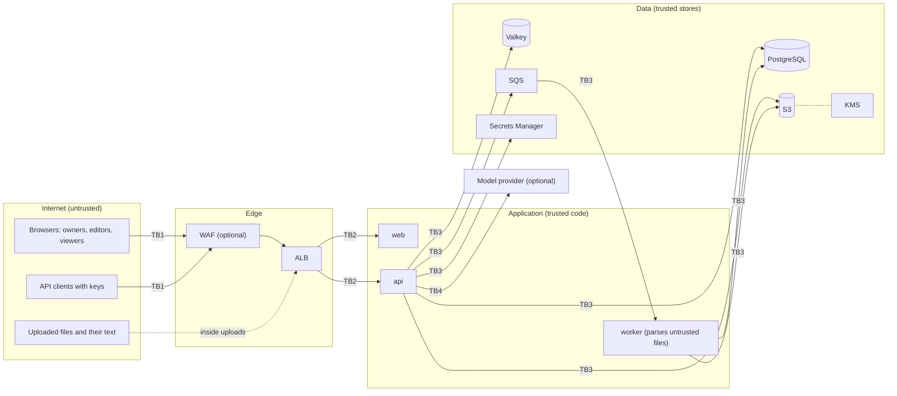

# Threat model

This is a STRIDE analysis of Euron DocMind as deployed by the Terraform in `infra/terraform`
(an `aws-prod`-shaped environment) with the defaults in the code. Each row names the
threat, the control that exists today and what remains. The controls themselves are
described in [security.md](security.md).

Residual risks are stated plainly. Where the residual is "accepted" it is a design choice;
where it is "open" it is a known gap.

## Scope and trust boundaries

| Boundary | Crossing |
| --- | --- |
| TB1 | Public internet to the edge: every request is untrusted |
| TB2 | Edge to tasks: TLS terminates at the ALB; tasks are in private subnets |
| TB3 | Application to its stores: IAM task roles, security groups, TLS to RDS and Valkey |
| TB4 | API to a third-party model provider, only when one is configured |
| Content | The bytes and text of uploaded files are untrusted even after they are stored: they are parsed by the worker and shown to the answerer |
| Logical | Workspace to workspace; role to role inside a workspace; a key to its workspace |

## Assets, ranked

| Rank | Asset | Why it ranks here |
| --- | --- | --- |
| 1 | Document contents: originals in S3, section and chunk text in Postgres, quotes in answers, messages and caches | The reason the product exists; often confidential (contracts, budgets, board material) |
| 2 | Signing and key material: `SESSION_SECRET`, `API_KEY_PEPPER`, the KMS key, the RDS master secret, the Valkey auth token | Each one forges sessions, validates forged keys, decrypts rank 1 or opens a store |
| 3 | Owner accounts and sessions | Full authority over a workspace: members, keys, deletion |
| 4 | API keys | Bearer access to one workspace, often stored in other systems |
| 5 | Other accounts and sessions | Read (and for editors, change) a workspace's documents |
| 6 | Questions and conversation history | Reveal what people are looking for |
| 7 | Audit trail and usage data | Accountability and the insights page |
| 8 | Terraform state | Contains the generated application secrets |
| 9 | Availability of answering and ingestion | The product's value depends on both |

## Spoofing

| Threat | Mitigation | Residual |
| --- | --- | --- |
| Password guessing | Argon2id; 8 failures lock the account for 15 minutes; 10 sign-in attempts per IP per minute, shared across tasks through Valkey; password policy | The per-IP limit keys on the client address uvicorn derives from `X-Forwarded-For`; only peers in `FORWARDED_ALLOW_IPS` (the VPC range on AWS, localhost elsewhere) are trusted to set it, so the address the load balancer appends is used and values a client prepends are ignored. Lockout can be triggered deliberately to keep someone out for 15 minutes (accepted) |
| No second factor | None | There is no TOTP or WebAuthn (open, roadmap) |
| Stolen session cookie | `HttpOnly`, `Secure`, `SameSite=Lax`; 7-day lifetime; sign-out denylist; a password change ends every other session | No dedicated "sign out everywhere" action besides changing the password (open, low). The web app sets no Content-Security-Policy (open) |
| Forged session token | HS256 with a 64-character generated secret on AWS; the boot guard refuses default or short secrets and a secret equal to the pepper; audience and issuer checked | Anyone holding `SESSION_SECRET` can mint sessions for any user (see rank 2) |
| Stolen or leaked API key | Stored only as an HMAC with a server pepper; revocable at once; optional expiry (90 days by default in the UI); `last_used_at` shown to owners | Keys are bearer secrets with no IP restriction (open, low). A key created through the API without `expires_in_days` never expires (accepted, visible in the list) |
| Account takeover through a temporary password | Generated, 14 random characters, shown once to the owner who added the member | The new member is not forced to change it at first sign-in, and the owner has seen it (open) |
| First sign-up becomes administrator | Sign-up is open only while the deployment has no account | Whoever reaches a fresh deployment first claims it; create the first account before exposing the URL (operator checklist) |

## Tampering

| Threat | Mitigation | Residual |
| --- | --- | --- |
| Cross-workspace writes by id | Every repository query takes the resolved `workspace_id`; the isolation sweep checks rename, reprocess and delete from outside | Application-level only; no row-level security in Postgres (open, roadmap) |
| Altering stored originals | Private, versioned bucket with SSE-KMS; only the API role may write, only under `workspaces/*` | Anyone with the API role's credentials can overwrite objects (inherent) |
| Forged ingestion messages | Only the API and worker roles may send to the queue; messages carry ids, and the worker re-reads and locks the row, so a duplicate or stale message changes nothing | n/a |
| Poisoning the answer cache | Only the application writes it; keys include the workspace, corpus version, scope and generator version | A cached answer keeps the document titles it was given until the corpus changes or the entry expires; a rename alone does not retire it (accepted) |
| Supply-chain tampering | `uv.lock` and `pnpm-lock.yaml` with frozen installs; pinned base images; immutable ECR tags; scan on push | No image signing or provenance verification at deploy time (open) |
| Request tampering in transit | TLS 1.2+ at the ALB, HTTP redirected; TLS to RDS (`rds.force_ssl`) and Valkey | ALB to task traffic is plain HTTP inside private subnets (accepted) |

## Repudiation

| Threat | Mitigation | Residual |
| --- | --- | --- |
| A member denies a change | `audit_events` for workspace settings, members and roles, uploads, renames, reprocessing, deletions and API keys, with the acting user or key | Reading, downloading and asking are not in the audit trail; answers and searches are only counted in `usage_events` with the asker (open) |
| Tampering with the audit trail | Owners read it; no API deletes entries | It lives in the same database, writable by the same role; it is not append-only or tamper-evident (open) |
| Missing request trace | JSON logs with a request id on every line and response | ALB access logs are opt-in (`alb_access_logs_bucket`); WAF logging is not configured by the modules (open) |

## Information disclosure

| Threat | Mitigation | Residual |
| --- | --- | --- |
| Cross-workspace reads, searches or citations | Membership resolved on every request (`404` for outsiders); retrieval filters by `workspace_id` in SQL before ranking; document scopes intersected with the workspace's ready documents; cache keys include the workspace; isolation sweep over 23 endpoints | Application-level only (as for tampering) |
| Prompt injection from an uploaded document | Default extractive answerer has no model to instruct; with a model, sources are fenced and declared as data, citations are verified, retrieval never crosses workspaces; the answer renderer supports no links or images, so an answer cannot make the browser fetch a URL | A planted document can still steer a model's answer for people in the same workspace (they can read the document anyway). Fencing narrows injection; it is not a boundary (accepted, documented) |
| Document text sent to a model provider | Off by default; per-workspace extractive override; provider key in Secrets Manager | When enabled, questions, recent turns and retrieved passages leave the deployment for every uncached answer (accepted per deployment) |
| Leaked database dump or backup | RDS storage and snapshots encrypted with the deployment key; originals are not in the database | Section and chunk text, messages and cached answers are plain text inside the database; embeddings can be partly inverted (accepted) |
| Data after deletion | Deleting a document removes its rows and its object and retires cached answers through the corpus version; deleting a workspace cascades | Previous object versions stay in the versioned bucket until noncurrent expiry (90 days); backups keep rows until their retention; conversations keep answers that quoted the document; retired cache entries stay unreachable until they expire (accepted, documented) |
| Over-broad roles | Viewer, editor and owner checked per route; keys are never owners and cannot use account endpoints | Every member can read every document of the workspace; there is no per-document access control (accepted, product scope) |
| Secrets in logs | Redaction by key name; request logs use route templates, not raw paths | Redaction is by field name; a new field carrying a secret under another name would be logged (process control) |
| Error messages leak internals | `500` responses never echo the exception | None identified |
| Terraform state exposure | `backend.tf.example` for a private, versioned, encrypted bucket | Local state on a laptop holds the secrets in plain text (operator responsibility) |

## Denial of service

| Threat | Mitigation | Residual |
| --- | --- | --- |
| Request floods | Optional WAF with a per-IP rate rule (2000 per 5 minutes); per-principal rate limits on answers, search and uploads; autoscaling | Without `enable_waf` (the `aws-dev` setting) there is no edge rate limit (accepted for dev) |
| Huge uploads | Body limit before parsing; per-file size limit; 20 files per request; upload rate limit | n/a |
| Decompression bombs and pathological files | Archive guards (entries, ratio, total size), page and row limits, a processing timeout, parsing in the worker rather than the API | Parsing runs in a thread that cannot be cancelled: after the timeout the document fails but the thread finishes in the background, holding memory meanwhile; a worker task's memory limit bounds the blast radius (open) |
| Expensive questions with a hosted model | Chat rate limit per principal; context budget; both cache levels | Provider spend scales with the number of principals within their limits (accepted) |
| Ingestion backlog | SQS buffers; workers autoscale on CPU; backlog-age alarm; the reaper does not re-send waiting documents while the queue has a backlog | n/a |
| Poison documents | Parse errors fail immediately; other errors retry with back-off and fail on the third attempt; messages a crashing worker never completes go to the dead-letter queue (alarmed) | n/a |
| Valkey outage | Readiness reports it; caches fail open | Session revocation checks and rate limits need Valkey, so authenticated requests fail while it is down (fail closed, accepted) |
| Database connection exhaustion | Bounded pool per task (10 plus 10 overflow); idle-in-transaction timeout; alarm at 80 percent of the configured ceiling | The alarm ceiling (200) is a module input, not read from the instance class; size it per instance (open, low) |

## Elevation of privilege

| Threat | Mitigation | Residual |
| --- | --- | --- |
| Viewer performs editor or owner actions | Role dependency on every route; tests for viewer and editor limits | n/a |
| Key escalates its access | Keys are `viewer` or `editor` only, cannot create keys or manage members (owner routes), cannot use account endpoints | n/a |
| Orphaning a workspace | The last owner cannot be demoted, removed or leave | An owner can make anyone an owner (by design) |
| Exploiting a parser with a crafted file | Type and archive checks first; maintained parser libraries; the worker's IAM role can only read objects and use the queue | The worker connects to the database as the RDS master user, so code execution in the worker means full database access (open: a least-privilege database role is on the roadmap) |
| Container escape or persistence | Non-root users, read-only root filesystem, no public IP, Fargate isolation | Standard Fargate isolation is relied upon (accepted) |
| Compromised API task | Least-privilege IAM per service; KMS use only through S3, SQS and Secrets Manager | A compromised API task can read every workspace (it must, to serve them) |

## Review triggers

Revisit this document when any of these change: a new unauthenticated route, a new file
format or parser, a new model or embedding provider, tools or browsing for the answerer,
link or image rendering in answers, a change to token lifetimes or storage, per-document
permissions, or row-level security.
